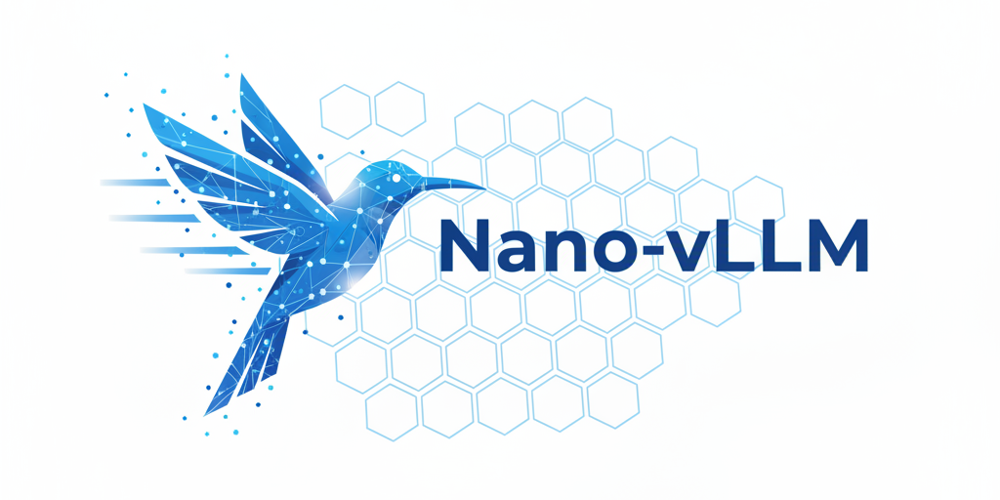

<p align="center">
  
</p>

# CAI-vLLM

CAI-vLLM 是一个用于学习现代大模型推理系统的轻量级 vLLM 实现。代码保持紧凑、可读，并覆盖前缀缓存、张量并行、Torch 编译和 CUDA Graph 等关键优化。

本仓库基于 MIT 许可的 [GeeeekExplorer/nano-vllm](https://github.com/GeeeekExplorer/nano-vllm) 演进；当前仓库由 `caiqiyue` 独立维护，Git 历史从 CAI-vLLM 的初始化提交重新开始。

## 主要特性

- 快速离线推理：核心 API 与 vLLM 类似。
- 教学友好：核心实现规模小，适合阅读调度、KV Cache、Attention 与模型加载流程。
- 推理优化：支持前缀缓存、张量并行、Torch 编译和 CUDA Graph。
- Agent Harness：内置 WIP=1、可执行验证、证据留存和 session 交接机制。

## 环境要求

- Python 3.10-3.12
- NVIDIA GPU 与匹配的 CUDA/PyTorch 环境
- Linux 推荐；FlashAttention/Triton 在原生 Windows 环境通常不可用

## 安装

```bash
pip install git+https://github.com/caiqiyue/cai-vllm.git
```

开发模式：

```bash
git clone https://github.com/caiqiyue/cai-vllm.git
cd cai-vllm
pip install -e .
```

> 发行包名是 `cai-vllm`，为兼容原有示例，Python 导入名仍为 `nanovllm`。

## 下载模型

```bash
huggingface-cli download Qwen/Qwen3-0.6B \
  --local-dir ~/huggingface/Qwen3-0.6B/
```

## 快速开始

```python
from nanovllm import LLM, SamplingParams

llm = LLM("/YOUR/MODEL/PATH", enforce_eager=True, tensor_parallel_size=1)
sampling_params = SamplingParams(temperature=0.6, max_tokens=256)
outputs = llm.generate(["Hello, CAI-vLLM."], sampling_params)
print(outputs[0]["text"])
```

完整示例见 [`example.py`](example.py)，性能脚本见 [`bench.py`](bench.py)。两者都需要兼容的 NVIDIA GPU、CUDA 运行时和模型权重。

## Harness 工作流

每个 agent session 从以下命令开始：

```bash
cat AGENTS.md
cat feature_list.json
bash ./init.sh
```

PowerShell 可运行：

```powershell
./init.ps1
```

轻量验证会检查 Python 版本、WIP=1 状态、两份 feature list 的一致性、源码语法、包元数据和 Git 空白错误。缺少可用 PyTorch/CUDA 时会明确显示 `SKIP`；涉及 GPU 行为的发布验证必须运行：

```bash
CAI_VLLM_REQUIRE_GPU=1 bash ./init.sh
```

关键文件：

- `AGENTS.md`：仓库级操作规则和启动/收班流程。
- `feature_list.json`：功能状态机，任何时刻只允许一个 `in_progress`。
- `claude-progress.md`：已验证状态与 session 日志。
- `session-handoff.md`：跨 session 交接卡。
- `.ai/`：策略、角色、验证清单和标准交付流程。
- `evidence/`：可复跑的验证日志。

## 基准数据（上游参考）

以下数据来自上游项目，尚未在本仓库当前环境重新验证：

| 推理引擎 | 输出 Token | 时间（秒） | 吞吐（Token/s） |
| --- | ---: | ---: | ---: |
| vLLM | 133,966 | 98.37 | 1,361.84 |
| nano-vLLM | 133,966 | 93.41 | 1,434.13 |

测试配置为 RTX 4070 Laptop 8GB、Qwen3-0.6B、256 个序列，输入和输出长度随机采样于 100-1024 Token。请用 `bench.py` 在自己的环境中复测，不要把上游数据视为 CAI-vLLM 的当前性能承诺。

## License

本项目沿用 [MIT License](LICENSE)。
